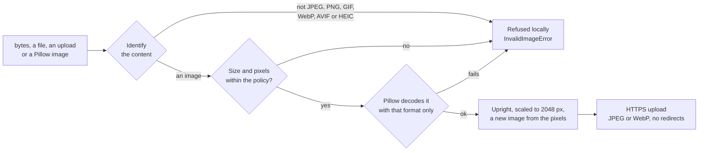

# dockaccess alt generator for Python

Alt text for your images from the [dockaccess.org](https://dockaccess.org) AI alt generator, in any
Python application or pipeline:

- a **sync and an async client** (`AltGenerator`, `AsyncAltGenerator`) that work in any framework,
  in Celery and RQ tasks, in Airflow, Prefect or Dagster steps and in plain scripts,
- a **CLI for pipelines** (`dockaccess-alt`): connect once, then generate alts for whole folders in CI,
  with a manifest that skips unchanged images and exit codes a pipeline can act on,
- thin helpers for **FastAPI** (and Starlette), **Django** and **Flask**,
- a **fake** of the service for your own tests.

It keeps the guarantees of the other dockaccess.org integrations (WordPress, PrestaShop, Joomla, Magento,
Laravel, Symfony):

- **only genuine images leave the server.** Every file is identified from its content, checked against
  size and pixel limits before it is decoded, and rebuilt from its pixels. An SVG with a script, a shell
  script named `photo.png` or a decompression bomb is refused locally and never reaches the network.
- **no metadata leaks.** GPS positions, camera serials, author names, ICC profiles, comments, embedded
  thumbnails and anything appended to the file stay on your server.
- **the account key does not leak** into exception messages, `repr()`, pickled task arguments or the
  `httpx` request log.

The threat model and what each layer guarantees are in [SECURITY.md](SECURITY.md).

## Contents

- [Requirements](#requirements) · [Installation](#installation) · [Connecting](#connecting)
- [Generating](#generating) · [Images](#images) · [Options](#options) · [Results](#results)
- [FastAPI](#fastapi) · [Django](#django) · [Flask](#flask) · [Background jobs](#background-jobs)
- [Pipelines and the CLI](#pipelines-and-the-cli) · [Batches in Python](#batches-in-python)
- [Limits](#limits) · [The connection check](#the-connection-check) · [Synchronisation](#synchronisation)
- [Errors](#errors) · [Configuration](#configuration) · [Testing your application](#testing-your-application)
- [Development](#development)

## Requirements

- Python 3.10 or newer
- a dockaccess.org account with the alt generator switched on for the site (the free plan works)
- installed for you: [httpx](https://www.python-httpx.org/) and [Pillow](https://python-pillow.org/).
  AVIF needs a Pillow built with AVIF (`python -c "from PIL import features; print(features.check('avif'))"`),
  HEIC needs the `heif` extra.

## Installation

```bash
pip install dockaccess-alt-generator
```

Extras pull in what a helper needs, if your project does not have it already:

```bash
pip install "dockaccess-alt-generator[fastapi]"   # or [django], [flask]
pip install "dockaccess-alt-generator[heif]"      # HEIC photos from iPhones (pillow-heif)
```

With uv or Poetry: `uv add dockaccess-alt-generator`, `poetry add dockaccess-alt-generator`.

## Connecting

The application connects to your dockaccess.org account once, the way the CMS plugins do:

```bash
dockaccess-alt connect
dockaccess-alt status
```

`connect` asks for:

1. the **site token** - in your dockaccess.org account open *My sites*, the site, then the *ALT generator* tab;
2. the **public address** of the application - one of the site's domains (`http://localhost:8000` is
   accepted too, for development);
3. the **e-mail address and password** of the dockaccess.org account. The password is used once and is not stored.

It writes the connection to `.env`, created readable by its owner only:

```dotenv
DOCKACCESS_ALT_KEY=...           # the key the generator is called with
DOCKACCESS_ALT_SITE_TOKEN=...    # the site in the account
DOCKACCESS_ALT_SECRET=...        # the connection secret (connection check, pushes)
DOCKACCESS_ALT_HOME_URL=...      # the address it was connected with
```

The connected application appears in the account (the *ALT generator* tab of the site) as *Python*, with
the time it last checked in. The owner can disconnect it there.

- `.env` is not loaded by magic: use python-dotenv, pydantic-settings, `docker --env-file`, or
  `Config.from_env(env_file=".env")`.
- With a secrets manager, `--show` prints the values instead of writing the file. Keep that output out of logs.
- In CI: `dockaccess-alt connect --no-input --token ... --login ... --url https://example.com` with the
  password in `DOCKACCESS_PASSWORD`.
- `--overwrite` replaces another installation's connection at the same address (that installation stops
  working). `--callback-url` registers where the account may push edited alts ([Synchronisation](#synchronisation)).
- `dockaccess-alt disconnect` removes the connection and the keys.

## Generating

```python
from dockaccess_alt import AltGenerator

generator = AltGenerator.from_env(env_file=".env")   # DOCKACCESS_ALT_* from the environment, else .env
                                                     # one per process, thread-safe

with open("media/products/oak-table.jpg", "rb") as photo:
    result = generator.generate(photo, language="pl", context="Product: oak dining table, 180 cm")

print(result.text)          # "Dębowy stół do jadalni na prostych nogach, na jasnym tle"
result.image_uuid           # the image in the account - keep it to send an edited alt back
```

The same, async (asyncio and trio):

```python
from dockaccess_alt import AsyncAltGenerator

async with AsyncAltGenerator.from_env() as generator:
    result = await generator.generate(upload, language="de_AT")
```

The image is decoded and rebuilt in a worker thread, so it never blocks the event loop.

The alt is already one line of plain text (no markup, control characters, invisible direction overrides),
but it is text from outside: let your template escape it, as Jinja2 and Django templates do.

## Images

`generate()` and `prepare()` take:

| What | Example |
|---|---|
| bytes | `generator.generate(s3_object["Body"].read(), name="hero.jpg")` |
| a binary file | `open(path, "rb")`, `io.BytesIO(...)` - read from its start and left where it was |
| an upload | FastAPI/Starlette `UploadFile`, Django `UploadedFile` or `FieldFile`, Werkzeug `FileStorage` |
| a Pillow image | `generator.generate(Image.open(...))`, a frame of a video, a rendered chart |
| an `ImageSource` | `ImageSource.from_path(path, within=MEDIA_ROOT)` |

A path is never read implicitly. `ImageSource.from_path(path, within=directory)` reads a file only if its
real path (symlinks resolved) lies inside the directory you name, so a path from a request cannot point at
`settings.py`. Name the narrowest directory that holds images: `settings.MEDIA_ROOT`, the uploads folder,
never the project root.

What happens to an image before anything is sent:



| File | Result |
|---|---|
| 4000 × 3000 photo, EXIF orientation 6 with GPS, owner, comment and ICC profile | Sent as a JPEG, 1536 × 2048, upright, no metadata |
| 800 × 600 PNG with transparency | Sent as a WebP, `logo.webp` |
| PNG with an alpha channel that is fully opaque | Sent as a JPEG |
| 16-bit PNG, CMYK JPEG, palette PNG, GIF, AVIF | Sent as an 8-bit JPEG |
| SVG with a script | Refused: `unsupported_format` |
| A shell script named `photo.png` | Refused: `unsupported_format` |
| HTML behind a GIF signature | Refused: `malformed` |
| PNG claiming 60000 × 60000 px | Refused: `bad_dimensions` (before decoding) |
| PNG with a broken checksum, a truncated JPEG | Refused: `malformed` |

`generator.prepare(image)` runs all of this without sending anything and without a key - to refuse a bad
file at upload time or before queueing a batch. The upload name is the original base name reduced to
`[A-Za-z0-9_-]` with the extension of the format actually sent; it never decides what the file is.

`ImagePolicy` narrows what is accepted:

```python
from dockaccess_alt import Config, ImagePolicy

config = Config.from_env(image_policy=ImagePolicy(
    max_bytes=5 * 1024 * 1024,        # at most the API's 10 MiB
    max_edge=1600,                    # longest side of the image sent
    formats=frozenset({"jpeg", "png", "webp"}),
))
```

## Options

```python
from dockaccess_alt import GenerateOptions, Tone

result = generator.generate(
    photo,
    language="de_AT",                 # any locale: reduced to a language the generator writes ("de")
    tone=Tone.DESCRIPTIVE,            # see TONES
    context="Product: oak dining table, 180 cm",   # up to 500 characters, plain text
    variants=3,                       # 1 to 3 alternatives; one image counts once either way
    set_ref="shop-42",                # groups images into one set in the account (default: the site token)
)
```

Keyword options override the defaults for one call. Defaults come from the environment
(`DOCKACCESS_ALT_LANGUAGE`, `_TONE`, `_CONTEXT`, `_VARIANTS`, `_SET_REF`) or from
`Config(defaults=GenerateOptions(language="pl", tone="formal"))`.

An unsupported language raises `ConfigurationError`. For locales that may be anything (a user's profile, a
CMS), map them first: `normalize_language(locale, "en")` falls back, `try_normalize_language(locale)`
returns `None`. `LANGUAGES` lists the 84 languages, `TONES` the 19 tones.

## Results

```python
result.text                 # the first alt's text
result.alt                  # Alt(text, locale)
result.alts                 # every variant
result.language             # "pl"
result.image_uuid           # the image in the account
result.set_uuid             # the set it joined
result.image                # what was sent: .format, .width, .height, .size, .sha256, .name
result.to_dict()            # JSON-ready, without the image bytes
```

## FastAPI

```python
from contextlib import asynccontextmanager

from fastapi import FastAPI, UploadFile
from dockaccess_alt import AltGeneratorError
from dockaccess_alt.fastapi import AltGeneratorDep, alt_generator_exception_handler, alt_generator_lifespan


@asynccontextmanager
async def lifespan(app: FastAPI):
    async with alt_generator_lifespan(app):      # one AsyncAltGenerator, closed on shutdown
        yield


app = FastAPI(lifespan=lifespan)
app.add_exception_handler(AltGeneratorError, alt_generator_exception_handler)


@app.post("/products/{product_id}/photo")
async def upload_photo(product_id: int, photo: UploadFile, generator: AltGeneratorDep):
    result = await generator.generate(photo, language="pl", context=f"Product {product_id}")
    # save photo, result.text and result.image_uuid with the product
    return {"alt": result.text}
```

The exception handler answers a refused image with 422, a spent limit with 429 and an unavailable
generator with 503, with messages that reveal nothing about your account. In Starlette, Litestar or Quart,
open `AsyncAltGenerator.from_env()` in the lifespan and keep it on the application state the same way.

## Django

```python
# settings.py
INSTALLED_APPS = [..., "dockaccess_alt.django"]   # optional: Polish messages of the validator
DOCKACCESS_ALT = {"CONTEXT": "Handmade furniture shop"}   # optional; KEY, SITE_TOKEN, SECRET come from the env
```

The language follows `LANGUAGE_CODE` unless `DOCKACCESS_ALT_LANGUAGE` or `DOCKACCESS_ALT["LANGUAGE"]` says
otherwise. Keys of `DOCKACCESS_ALT` are the environment variables without the `DOCKACCESS_ALT_` prefix.

```python
# models.py
from dockaccess_alt.django.validators import validate_image

class Product(models.Model):
    photo = models.ImageField(upload_to="products/", validators=[validate_image])
    photo_alt = models.CharField(max_length=500, blank=True)
    photo_alt_uuid = models.CharField(max_length=36, blank=True)
```

```python
# anywhere: a view, a signal handler, a task
from dockaccess_alt.django import get_alt_generator

result = get_alt_generator().generate(product.photo, context=product.name)
product.photo_alt, product.photo_alt_uuid = result.text, result.image_uuid
product.save(update_fields=["photo_alt", "photo_alt_uuid"])
```

`get_alt_generator()` is one thread-safe generator per process. `validate_image` checks the upload by its
content, the way the generator will, without a connection; its `ValidationError.code` is the reason
(`unsupported_format`, `malformed`...). A `FieldFile` is read through its storage, so S3 works too.

## Flask

```python
from flask import Flask, request
from dockaccess_alt.flask import DockAccessAlt, get_alt_generator, register_error_handler

app = Flask(__name__)
DockAccessAlt(app)               # DOCKACCESS_ALT_* from app.config, else the environment
register_error_handler(app)      # 422 / 429 / 503 JSON answers


@app.post("/images")
def upload():
    result = get_alt_generator().generate(request.files["photo"], language="pl")
    return {"alt": result.text}
```

`DockAccessAlt().init_app(app)` works with the application factory pattern.

## Background jobs

Generation takes a few seconds; in a web request that is fine for one image, in a batch it belongs in a
task. Pass identifiers to the task, never the generator or the key (a `Secret` refuses to be pickled on
purpose):

```python
# Celery
from celery import shared_task
from dockaccess_alt import RateLimitedError, ServerError, TransportError
from dockaccess_alt.django import get_alt_generator


@shared_task(bind=True, max_retries=5)
def generate_alt(self, product_id: int) -> None:
    product = Product.objects.get(pk=product_id)
    try:
        result = get_alt_generator().generate(product.photo, context=product.name)
    except RateLimitedError as error:
        raise self.retry(countdown=error.retry_after)
    except (ServerError, TransportError) as error:
        raise self.retry(countdown=60) from error
    Product.objects.filter(pk=product_id).update(photo_alt=result.text, photo_alt_uuid=result.image_uuid)
```

Do not retry `InvalidImageError`, `ImageRejectedError`, `LimitReachedError`, `AuthenticationError` or
`GeneratorUnavailableError`: nothing about them changes on a retry. Every error of the package pickles with
its attributes, so the result backend keeps the reason.

## Pipelines and the CLI

```bash
dockaccess-alt generate static/img -r --lang pl --manifest alts.json
```

- Directories are walked for `.jpg .jpeg .png .gif .webp .avif .heic` files (`-r` for subdirectories);
  a file named on the command line is always tried. Content decides, as everywhere.
- `--manifest alts.json` keeps every generated alt per image and language, with the SHA-256 of the file.
  The next run generates only new and changed images, so a nightly job costs only what changed. The
  manifest is written after each image, so a stop keeps the progress.
- `--format jsonl` prints one JSON object per image, for the next step of the pipeline. Progress and the
  summary go to stderr.
- `--max 50` caps the generations of one run; `--dry-run` and `dockaccess-alt check` verify the images
  without sending anything (no key needed).
- The per-minute cap is waited out; a spent limit stops the run.

```json
{
  "version": 1,
  "images": {
    "static/img/oak-table.jpg": {
      "sha256": "9f2c...",
      "languages": {
        "pl": {"alt": "Dębowy stół...", "variants": ["Dębowy stół..."], "image_uuid": "...", "set_uuid": "...", "generated_at": "2026-11-06T10:00:00Z"}
      }
    }
  }
}
```

Exit codes:

| Code | Meaning |
|---|---|
| 0 | Done |
| 1 | Some images failed (refused or rejected); the rest were generated |
| 2 | A usage or configuration error (no key, a missing file, an invalid option) |
| 3 | Not connected, the key was refused, or the generator is off or paused for the site |
| 4 | The plan's limit is spent; run again after it renews |
| 5 | dockaccess.org could not be reached or failed |

A GitHub Actions job that keeps `alts.json` up to date:

```yaml
- run: pip install dockaccess-alt-generator
- run: dockaccess-alt generate static/img -r --lang en --manifest alts.json --max 200
  env:
    DOCKACCESS_ALT_KEY: ${{ secrets.DOCKACCESS_ALT_KEY }}
    DOCKACCESS_ALT_SITE_TOKEN: ${{ secrets.DOCKACCESS_ALT_SITE_TOKEN }}
    DOCKACCESS_ALT_SECRET: ${{ secrets.DOCKACCESS_ALT_SECRET }}
```

GitLab CI is the same with masked CI/CD variables. Your static site generator reads `alts.json`
(Hugo data files, Jinja2, MkDocs hooks, Astro).

## Batches in Python

```python
items = ((product.id, product.photo) for product in Product.objects.filter(photo_alt=""))

for item in generator.generate_many(items, language="pl"):
    if item.ok:
        Product.objects.filter(pk=item.key).update(photo_alt=item.result.text)
    elif item.stopped:
        print("Stopped:", item.error)      # the limit, the key, the site switched off
    else:
        print(item.key, "skipped:", item.error)
```

`generate_many()` takes images or `(key, image)` pairs and reads them one at a time. With
`within=directory`, string paths are read from inside that directory. One image after another, as the
CMS plugins' bulk runs do: a refused image is reported and skipped, the per-minute cap is waited out
(`max_rate_limit_waits`), and a spent limit, a refused key or a switched-off site stop the batch. The async
version is `async for item in generator.generate_many(...)`.

In Airflow, Prefect or Dagster, call the same API inside a task; keep the three `DOCKACCESS_ALT_*` values in
the orchestrator's secrets.

## Limits

```python
usage = generator.usage()

usage.used, usage.limit, usage.remaining   # 15, 2000, 1985
usage.is_monthly                           # True on paid plans
usage.resets_at                            # datetime in UTC, when the window renews
```

The free plan counts generations per UTC day, paid plans per UTC calendar month (a month's alts can go in
one day). The online tool, every connected site and the API share one pool. A spent limit raises
`LimitReachedError` with `.period` (`"day"` or `"month"`) and `.limit`. The API also allows 30 generations
a minute; above that `RateLimitedError.retry_after` says how long to wait.

## The connection check

With the site token and the secret set (`dockaccess-alt connect` sets them), the generator asks dockaccess.org
whether the site may still generate before it sends an image, and remembers the answer for 5 minutes
(`DOCKACCESS_ALT_VERIFY_TTL`). It raises `GeneratorUnavailableError` with `.reason`:

| `reason` | What happened | What to do |
|---|---|---|
| `disconnected` | The owner disconnected the application in the account | `dockaccess-alt connect` |
| `alt_disabled` | The generator was switched off for the site | Switch it on in the account |
| `alt_paused` | The plan paused it (e.g. more sites than the plan allows) | Upgrade the plan or free up a site |

When dockaccess.org cannot be reached, generation goes on (a warning is logged on the `dockaccess_alt`
logger) and the generator itself still enforces the limits. `DOCKACCESS_ALT_VERIFY=false` skips the check.

## Synchronisation

Send an alt edited in your application back to the account, so both show the same text:

```python
generator.update_alts(product.photo_alt_uuid, [(product.photo_alt, "pl")])
```

The account can also push alts edited there to your application, signed with the connection secret
(HMAC-SHA256 over the timestamp and the body, five minutes of clock skew, the same 401 for every signature
problem). The receivers are ready; register the address with `dockaccess-alt connect --callback-url`.
dockaccess.org does not send these pushes yet, so for now save corrections in your application as well.

```python
from dockaccess_alt.fastapi import alt_push_router            # FastAPI
from dockaccess_alt.django.views import alt_push_view         # Django
from dockaccess_alt.flask import alt_push_blueprint           # Flask (exempt it from CSRFProtect)


def save(pushed):                     # PushedAlts: image_uuid, image_url, alts (most relevant first)
    updated = Product.objects.filter(photo_alt_uuid=pushed.image_uuid).update(photo_alt=pushed.for_language("pl").text)
    return updated or None            # None: no local image matches (404)


app.include_router(alt_push_router(save))                     # POST /dockaccess/alts
```

Anywhere else: `parse_push(body, headers, secret=..., site_token=...)` verifies and reads a push or raises
`PushError` with the status to answer.

## Errors

Every error derives from `dockaccess_alt.AltGeneratorError`. None of them carries the account key, the
connection secret, a password, a URL query or image bytes.

| Error | Meaning | What to do |
|---|---|---|
| `InvalidImageError` | Refused locally, nothing was sent; `.reason`: `not_allowed`, `empty`, `too_large`, `unsupported_format`, `malformed`, `bad_dimensions`, `cannot_sanitize` | Show the reason; do not retry |
| `ConfigurationError` | Not connected, or an invalid setting or option | Fix the setup |
| `GeneratorUnavailableError` | The account says no; `.reason` (see above) | Connect again, switch it on, upgrade |
| `AuthenticationError` | The account key was not accepted | `dockaccess-alt connect` |
| `LimitReachedError` | The day's (free) or month's (paid) limit is spent; `.period`, `.limit` | Stop until it renews, or upgrade |
| `RateLimitedError` | Too many requests a minute; `.retry_after` seconds | Wait and retry |
| `ImageRejectedError` | The generator refused the image | Do not retry this image |
| `ServerError` | dockaccess.org failed (5xx) | Retry later with a backoff |
| `TransportError` | No complete answer; `.retryable` only when nothing reached the service | Retry later |
| `UnexpectedResponseError` | An answer the client does not understand | Log and report |
| `SiteConnectionError` | Connect, verify or disconnect was refused; `.reason` | See `dockaccess-alt connect` |

`ApiError.api_message` is the service's own explanation, cleaned to plain text.
`dockaccess_alt.errors.error_response(error)` turns any of them into `(status, body, headers)` for your own API.

## Configuration

Everything has an environment variable; `Config.from_env()` reads them, `Config(...)` takes the same as
arguments (`Config.from_env(timeout=60)` mixes both).

| Variable | `Config` field | Default | |
|---|---|---|---|
| `DOCKACCESS_ALT_KEY` | `account_key` | | The account key |
| `DOCKACCESS_ALT_SITE_TOKEN` | `site_token` | | The site in the account |
| `DOCKACCESS_ALT_SECRET` | `connection_secret` | | The connection secret |
| `DOCKACCESS_ALT_LANGUAGE` | `defaults.language` | `en` | Any locale |
| `DOCKACCESS_ALT_TONE` | `defaults.tone` | `neutral` | |
| `DOCKACCESS_ALT_CONTEXT` | `defaults.context` | | |
| `DOCKACCESS_ALT_VARIANTS` | `defaults.variants` | `1` | |
| `DOCKACCESS_ALT_SET_REF` | `defaults.set_ref` | the site token | The image set in the account |
| `DOCKACCESS_ALT_VERIFY` | `check_connection` | `true` | The connection check |
| `DOCKACCESS_ALT_VERIFY_TTL` | `verify_ttl` | `300` | Seconds an answer is remembered |
| `DOCKACCESS_ALT_TIMEOUT` | `timeout` | `90` | Seconds; generation includes an AI model call |
| `DOCKACCESS_ALT_CONNECT_TIMEOUT` | `connect_timeout` | `5` | |
| `DOCKACCESS_ALT_PROXY` | `proxy` | | `HTTPS_PROXY` and `NO_PROXY` are honoured too (`trust_env`) |
| `DOCKACCESS_ALT_CA_BUNDLE` | `ca_bundle` | certifi | `SSL_CERT_FILE` is honoured too; verification is never off |

Further fields: `connect_retries` (0 to 3, only failures before anything was sent), `max_alt_length`,
`user_agent_suffix`, `image_policy`.

## Testing your application

```python
from dockaccess_alt.testing import FakeAltApi

fake = FakeAltApi("A ginger cat on a windowsill")

generator = fake.generator()                  # or fake.async_generator()
# FastAPI: app.dependency_overrides[get_alt_generator] = lambda: generator
# Flask:   DockAccessAlt(app, transport=fake.transport)

...

fake.assert_generated(1)
fake.limit_reached()                          # the next generations answer 429 limit_reached
fake.rate_limited(retry_after=1, times=1)
fake.invalid_key()
fake.respond("/api/generate", httpx.Response(500, json={"detail": "down"}))
```

The fake answers like dockaccess.org without the network, a key or a limit. Images are still verified and
rebuilt as in production, so a test feeding a broken file still gets `InvalidImageError`.

## Development

```bash
python -m venv .venv && .venv/bin/pip install -e ".[fastapi,django,flask]" pytest anyio python-multipart mypy ruff
.venv/bin/pytest                    # unit, framework and CLI tests; the CLI against a local stub server
.venv/bin/mypy                      # strict
.venv/bin/ruff check src tests && .venv/bin/ruff format --check src tests
tests/docker/run.sh                 # Python 3.10 to 3.14 in Docker; `lowest` for the oldest dependencies
DOCKACCESS_ALT_NETWORK_TESTS=1 .venv/bin/pytest tests/test_network.py
```

The network tests call the real API with a made-up key, which the API refuses before it reads the image
(nothing is stored, no limit is used), and check certificate validation against badssl.com.

Releasing: set the version in `src/dockaccess_alt/_version.py` and `CHANGELOG.md`, run the checks above, then push a
tag named like the version (`1.0.1`). `.github/workflows/publish.yml` builds the package and uploads it to PyPI with
the `PYPI_API_TOKEN` repository secret, as the dock-ray package does. The workflow does not run the tests.

## License

MIT, see [LICENSE](LICENSE).
